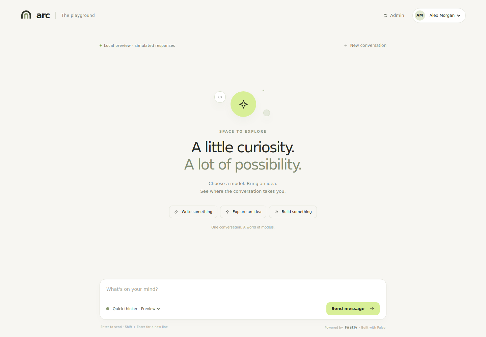

# ARC playground

A small chat demo built with **Pulse Native on Fastly Compute**. It demonstrates an application calling AI Runtime Control with an ARC virtual key. ARC continues to own provider credentials, routing, failover, usage accounting, and policy enforcement.

- Clean chat UI with animated bubbles, formatted responses, a top user switcher, and a bottom model selector and send button.
- Independent conversation history per demo user, kept in browser `sessionStorage` for the current tab. New conversation clears that user's history.
- Password-protected admin CRUD for users, virtual-key registrations, and model choices.
- One Fastly KV settings document. Last write wins; no transactional infrastructure.
- Same service serves the UI and API; no JavaScript runtime in the Fastly deployment artifact.



[Admin screenshot](docs/screenshots/admin.png) · [Mobile screenshot](docs/screenshots/mobile.png)

## Try it locally

Requires Node 22.14+ on the 22.x line or Node 24.x.

```sh
npm ci --ignore-scripts
npm run doctor
npm test
npm run dev
```

Open `http://127.0.0.1:8787`. Open `/admin` using **`local-admin-only`**. This password exists only in the local development fixture; it is not embedded as a deployed secret.

The local profile includes two demo users and two illustrative model choices. The connection label and response metadata explicitly identify simulated responses. No LLM calls are made in preview mode. Local KV lasts for the dev process; restarting restores the configured fixtures.

## Build for Fastly

```sh
npm run build
```

The explicit profile is `host: 'fastly', target: 'native'`. The package is generated under `dist/`, including `bin/main.wasm`, generated AssemblyScript, and manifests. `public/` assets are converted into static Pulse routes by `scripts/embed-assets.mjs` before build. Edit `public/`, not generated files.

Pulse packages are pinned to the published `1.0.0-beta.5` release and recorded in `package-lock.json`. This repository does not depend on a moving branch or an unpublished workspace build.

## Connect your ARC account

1. In Fastly ARC, configure your provider and create a virtual key. Keep provider API keys in ARC.
2. Obtain the **full OpenAI-compatible chat-completions URL** for your ARC account. The app sends `POST`, `Authorization: Bearer <virtual key>`, and `{ model, messages, stream: false }`. It expects `choices[0].message.content` as text. This adapter has not yet been verified against a live ARC account. Provider-specific APIs such as Anthropic Messages need an additional adapter.
3. In `.pulse/config.ts`, replace the `https://arc.example.invalid` backend origin with the origin of that URL. Keep its name `arc_backend`. Configure that Fastly backend with the matching host, TLS, SNI, and host override. Dynamic backends stay disabled.
4. Create and link the following resources to the Compute service. The names must match the profile:

   | Resource | Name | Contents |
   | --- | --- | --- |
   | Config Store | `arc_config` | `ARC_MODE=live`; `ARC_URL=<full URL>` |
   | Secret Store | `arc_secrets` | `ADMIN_PASSWORD=<your own strong password>` |
   | KV Store | `arc_state` | Initially empty; populated by Admin |
   | Backend | `arc_backend` | Your ARC endpoint origin |

5. Rebuild after changing the backend mapping. Deploy the generated `dist` package using your normal Fastly Compute service workflow. Build does not provision resources or deploy a service.
6. Open `/admin`, unlock with your deployed admin password, add the actual model IDs and an ARC virtual key, then add users assigned to that key. Return to chat and send a small prompt. Confirm the request and model in ARC's own logs.

Do not populate deployment resources with the local preview key or illustrative model IDs. `dev.config`, `dev.secrets`, and `dev.kv` are only local fixture inputs. On an empty deployment, the UI guides you to Admin. Missing admin secrets deny access; missing ARC URL returns a setup error. A failed live request never becomes a simulated response.

### What the virtual-key CRUD means

Admin registers ARC-issued keys for this demo and assigns them to demo users. It does **not** create or revoke credentials in the Fastly ARC control plane. Rotation here replaces the registered value; create/rotate/revoke the actual key in Fastly as appropriate. Deleting a key here clears its user assignments. Disabling a key or user stops new demo requests after KV propagation; requests already in flight may complete.

Virtual-key values are kept server-side in KV. Public bootstrap responses contain neither values nor assignments. Authorized admin requests can read the settings document, and all admin responses are `no-store`. The password and unlocked state stay in page memory and clear when leaving/reloading Admin. The UI masks key values and only asks for a replacement during editing. This is a demo convenience, not a vault.

### Demo boundaries

- User selection is impersonation for demonstrations, not identity verification. Chat is accessible to anyone who can reach the service. Use a controlled demo audience and ARC's key limits for paid use.
- Up to 30 users, 30 keys, and 30 models. Admin changes replace one settings document, so concurrent edits can overwrite one another. Fastly KV propagation may briefly show older state.
- Up to 20 messages forwarded per request, 8,000 characters per message, and 24,000 total characters. Previous messages are sent as context; no chat transcripts are stored in KV.
- Buffered responses, with a 25-second upstream timeout. No tools, uploads, autonomous calls, or streaming in this first version.
- Replies render a small safe Markdown subset (paragraphs, headings, lists, bold, inline/fenced code). Raw HTML is always text.
- Response metadata shows returned model, elapsed browser time, and actual token usage only when provided. No invented cost or failover telemetry.
- A per-conversation UUID is local bookkeeping. ARC session attribution remains unconfigured until the account's documented session header/body field is confirmed.

## Routes

| Route | Purpose |
| --- | --- |
| `GET /`, `GET /admin` | Chat and admin UI |
| `GET /app.css`, `GET /app.js` | Embedded frontend assets |
| `GET /health` | Health response |
| `GET /api/bootstrap` | Active public users and model choices |
| `POST /api/chat` | Validate selection; call ARC with server-selected key |
| `GET /api/admin/settings` | Read settings; requires admin bearer password |
| `PUT /api/admin/settings` | Validate and replace settings; requires admin bearer password |

CRUD lives in the admin UI over the bounded settings API. Removing a referenced token automatically unassigns it from users. Duplicate IDs and invalid references are rejected server-side.

## Checks

```sh
npm run typecheck
npm test
npm run build
```

`pulse test` covers public data redaction, admin authorization, settings validation, disabled/unknown key and model selection, message limits, endpoint setup, and upstream response/rate-limit behavior through the Fastly provider's local runtime. This is distinct from running compiled Wasm in Viceroy and from remote Fastly deployment. See `docs/validation.md` for the actual checks completed.

Optional compiled-host smoke (requires Viceroy):

```sh
VICEROY_BIN=/absolute/path/to/viceroy npm run test:native
```

ARC setup reference: [Getting started with AI Runtime Control](https://www.fastly.com/documentation/guides/platform/ai-runtime-control/getting-started-with-ai-runtime-control/).
